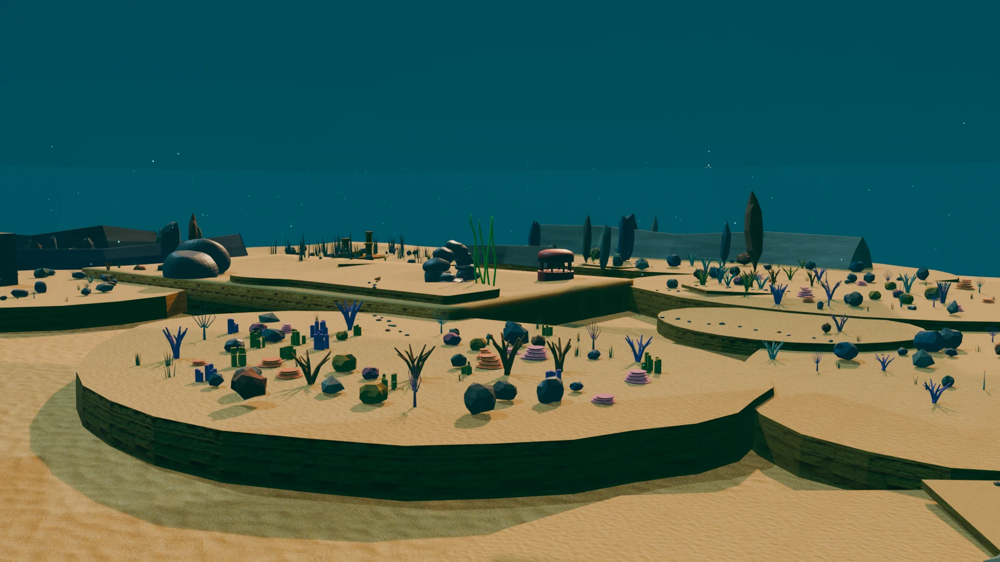
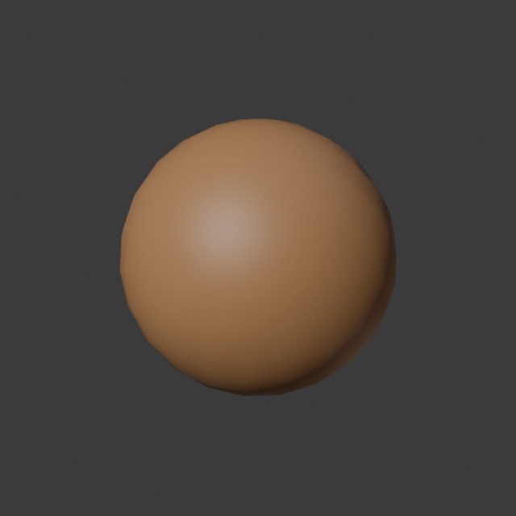
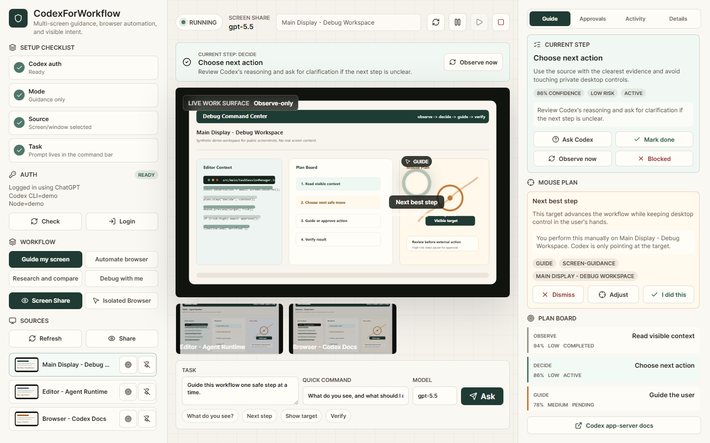

  

  <a href="https://curiocrafter.github.io/"><strong>Portfolio</strong></a>
  &nbsp;·&nbsp;
  <a href="https://curiocrafter.github.io/#/projects">Project case studies</a>
  &nbsp;·&nbsp;
  <a href="https://www.linkedin.com/in/andrew-rainsberger-2b9b721b1">LinkedIn</a>
  &nbsp;·&nbsp;
  <a href="https://curiocrafter.github.io/Andrew_Rainsberger_Game_Developer_Resume.pdf">Résumé</a>

## I make worlds—and the tools that make them possible.

I'm **Andrew Rainsberger**, a game developer and technical tools builder in Dixon, Missouri. I work where gameplay, technical art, and practical software overlap: playable 3D systems, authored environments, Blender/Python pipelines, and desktop tools that make difficult work easier to repeat.

What matters to me:

- **Feel first.** Movement, cameras, controls, feedback, and readable player choices make a system worth using.
- **Tools are part of the product.** Better authoring and validation workflows produce better worlds.
- **Show the evidence.** I value runnable builds, real captures, focused tests, and honest limits over polished claims.

`TypeScript` · `Three.js / WebGL` · `C++` · `Python` · `Blender API` · `React / Electron` · `C# / .NET`

---

## Flagship world — Tidefront / Ocean Drift

**A playable underwater survival world built across the full pipeline.** I worked on player movement, feeding, abilities, camera states, HUD, lobby flow, and simulation systems, then connected authored Blender terrain, coral, landmarks, and export data to the Three.js runtime.

`TypeScript` · `Three.js` · `WebGL2` · `Blender` · `WebSockets`

[Explore the case study →](https://curiocrafter.github.io/#/projects/ocean-supremacy) &nbsp;&nbsp; [See the Blender environment workflow →](https://curiocrafter.github.io/#/projects/tidefront-blender-workflow)

---

## Open source from the workbench

### [CurioMesh](https://github.com/CurioCrafter/CurioMesh) — practical quad remeshing for Blender

A Blender 4.3+ add-on with a production QuadriFlow path and an experimental standalone quad-dominant engine. It preserves the things artists care about—shape, features, materials, and UVs—while reporting useful quality metrics instead of hiding the result behind one button.

- Deterministic remeshing, projection, cleanup, and voxel-repair fallback
- UV and material transfer with measurable topology/quality reports
- Standalone OBJ CLI plus Blender headless smoke coverage
- MIT licensed and validated against Blender 4.5 LTS

[Repository and installation →](https://github.com/CurioCrafter/CurioMesh)

 

### [CodexForWorkflow](https://github.com/CurioCrafter/CodexForWorkflow) — human-approved desktop automation

A Windows command center for guided screen observation and isolated browser automation. The interesting problem is not just making automation work—it is making every step visible, stoppable, and appropriately gated.

- Observe-only live screen guidance
- Isolated Playwright browser with approval gates
- Visible plans, target overlays, pause/stop controls, and verification loops
- Local, loopback-only bridge with per-session authorization

[Repository, releases, and safety model →](https://github.com/CurioCrafter/CodexForWorkflow)

 

---

## More things I've built

- **[Deltawave](https://github.com/CurioCrafter/Deltawave)** — a native C++20 music visualizer with live WASAPI analysis, procedural 2D/3D scenes, adaptive audio profiles, deterministic export, and performance telemetry.
- **[Linear Drive](https://github.com/CurioCrafter/LinearDrive)** — a first-person survival-horror driving game in C++/raylib with a physical, diegetic cockpit and reactive road hazards. [View the cockpit case study.](https://curiocrafter.github.io/#/projects/linear-drive)
- **[MeasuringStick](https://github.com/CurioCrafter/MeasuringStick)** — a lightweight C# system-tray utility for pixel measurement and screenshot capture on Windows.
- **[A3DCO](https://github.com/CurioCrafter/A3DCO)**, **[ObservableKeymap](https://github.com/CurioCrafter/ObservableKeymap)**, and **[Blender Alignment Suite](https://github.com/CurioCrafter/blender-alignment-suite)** — small Blender add-ons built around everyday modeling friction.
- **[Claude Citizen — Solar Atlas contribution](https://github.com/huiung/claude-citizen/pull/10)** — 10 authored commits in a merged upstream PR covering navigation, pointer-lock safety, orbit selection, and visual polish. [Read the contribution case study.](https://curiocrafter.github.io/#/projects/claude-citizen)

---

## How I build

**1. Find the player or artist problem.** Start from the moment that feels slow, unclear, fragile, or unconvincing.

**2. Build a complete vertical slice.** Connect the interaction, visuals, data, and tooling early enough to expose the real problems.

**3. Test the result where it lives.** Browser playtests, Blender headless runs, geometry assertions, screenshots, builds, and performance checks all count as part of the work.

**4. Keep the limits visible.** Experimental work stays labeled experimental. Private work gets a public case study, not a pretend-open repository.

---

## The person behind the work

Before software, I completed electrical pre-apprenticeship training and served a season on a wildland firefighting crew through Job Corps. That background still shapes how I work: respect constraints, communicate clearly, learn the system, check the tools, and stay useful when conditions change.

I'm currently focused on **junior game development, tools development, and technical-art-adjacent roles** where I can keep bridging creative intent and engineering execution.

  <strong>Want the visual version?</strong> 
  <a href="https://curiocrafter.github.io/">Explore my portfolio</a>
  &nbsp;·&nbsp;
  <a href="mailto:andrewrainsberger@gmail.com">Email me</a>
  &nbsp;·&nbsp;
  <a href="https://www.linkedin.com/in/andrew-rainsberger-2b9b721b1">Connect on LinkedIn</a>

