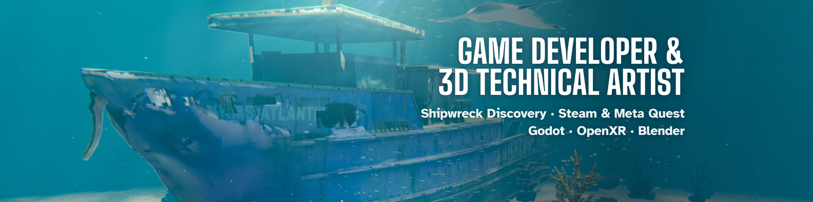

# Andrew Rainsberger

Game Developer & 3D Technical Artist at AquaticXR, and a credited developer on [Shipwreck Discovery](https://store.steampowered.com/app/3583270/Shipwreck_Discovery/), a VR diving game in Early Access on Steam and Meta Quest.

**[Portfolio](https://curiocrafter.github.io/)** · [Resume (PDF)](https://curiocrafter.github.io/Andrew_Rainsberger_Game_Developer_Resume.pdf) · [LinkedIn](https://www.linkedin.com/in/andrew-rainsberger-2b9b721b1/) · andrewrainsberger@gmail.com

## Shipwreck Discovery

A VR diving game set on real wrecks sunk as artificial reefs off Destin, Florida (Godot 4, OpenXR). I work on it full-time at AquaticXR:

- Coral growth, planting, placement and collision systems in Godot, and the wildlife balance around them.
- Retopology, UVs and PBR baking for coral growth stages and large wreck assets, delivered as Godot-ready GLB files that hold up on Quest.
- 37 animated seafloor species for the experimental branch, each placed by its real Gulf of Mexico habitat.
- VR interaction fixes with regression tests, plus the studio's trailers and shorts.

The game's source is private. Footage and details are on the [portfolio](https://curiocrafter.github.io/#shipwreck).

## Selected projects

- **[Sector War](https://curiocrafter.github.io/play/sector-war.html)**: real-time space strategy in the browser, with online multiplayer for up to eight players on a deterministic engine and 81 automated tests. Play it in your browser.
- **[Music Visualizer](https://github.com/CurioCrafter/music-visualizer)**: ten GPU shader worlds that react to the kick, snare, hi-hats, tempo and drop. Rust and wgpu in the Windows tray, and the same shaders in the browser.
- **[CurioMesh](https://github.com/CurioCrafter/CurioMesh)**: a Blender remesher that keeps materials and UVs intact.
- **[Topology Transitions](https://github.com/CurioCrafter/Topology-Transitions)**: a Blender add-on for guided all-quad edge-loop reductions and expansions, with a hole and manifold checker.
- **[VRBlender](https://curiocrafter.github.io/#vrblender)**: Blender 5.1 inside PC VR (OpenXR). Draw boxes, spheres and Boolean cutters with the controller triggers.

## How I work

I build with AI coding agents and say so plainly: Claude Opus 5.5 on my current work, ChatGPT Codex on earlier projects. I set the direction, review the code and test everything in the engine and in the headset.

## Toolkit

Godot 4 · GDScript · OpenXR · Blender and its Python API · retopology, UVs and PBR baking · Python · TypeScript · Three.js · WebGL · WebGPU · Rust · C++ · Git

## Also

I run CurioCrafter on YouTube with my family: 94.5 million views and 88,000 subscribers (October 2026). Before games I trained as an electrician and served a season on a Job Corps wildland firefighting crew.

Based in Joplin, Missouri. Open to gameplay, VR and technical art roles: remote, hybrid or on-site.
